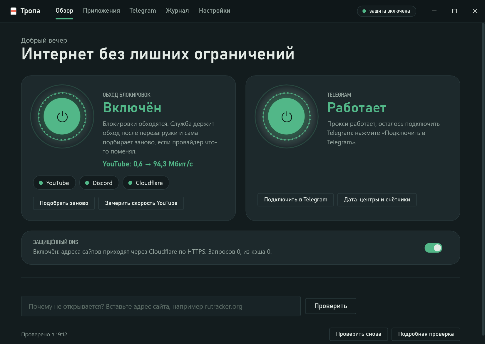

# Тропа

**Русский** · [English](README.en.md) · [Сайт](https://xckrt.github.io/Tropa/)

Тропа — программа для Windows, которая сама разбирается, что и как режет провайдер, и настраивает обход:
YouTube, Discord (вместе с голосом), Telegram, игры и любые сайты. Нажимаете одну кнопку — дальше Тропа держит
всё сама, в том числе после перезагрузки и смены сети.



## Установка

Скачайте **Tropa-Setup-x.y.z.exe** со страницы [релизов](https://github.com/xckrt/Tropa/releases/latest) и
запустите. Windows один раз спросит разрешение администратора: Тропа ставит службу, которая держит обход.
.NET ставить не нужно. Удаляется Тропа как обычная программа.

Без установки — **Tropa-Portable-x.y.z.zip**: распакуйте и запустите `Tropa.exe`. Обход работает, пока открыта
Тропа, данные хранятся в папке `data` рядом.

## Что умеет

- **Обход блокировок одной кнопкой.** Тропа проверяет каждый сервис по этапам (DNS → TCP → TLS → HTTP →
  передача) и понимает, как именно режут: RST по имени сайта, тихий дроп, «заморозка на 16 КБ», подмена DNS.
  Под этот диагноз она перебирает стратегии [zapret](https://github.com/bol-van/zapret), от простых к сложным,
  и включает ту, что прошла все проверки. Служба следит дальше и сама подбирает заново, если провайдер что-то
  поменял.
- **Telegram.** Встроенный прокси: трафик уходит через WebSocket веб-версии Telegram, который режут реже, а при
  неудаче — через Cloudflare. Это порт [tg-ws-proxy](https://github.com/Flowseal/tg-ws-proxy), работает внутри
  службы без Python. Тропа сама добавляет прокси в Telegram и проверяет каждый дата-центр.
- **Голос Discord.** Голос проверяется по-настоящему, UDP-пакетом на голосовые серверы. Если он не проходит,
  Тропа сама подбирает вариант голосового профиля.
- **Защищённый DNS.** Запросы системы уходят через DNS-over-HTTPS (Cloudflare, Google, Quad9). Провайдер не видит
  их и не может подменить. Если DoH перестанет отвечать, Тропа вернёт прежний DNS, а интернет не встанет.
- **Свои приложения.** Нажмите «Выбрать запущенную программу», поиграйте полминуты, и Тропа сама соберёт домены
  и порты игры. Есть и заготовки: Dead by Daylight, Roblox, Twitch.
- **Профили сетей.** Дома одна стратегия, на мобильном интернете другая. Тропа узнаёт сеть и включает её профиль.
- **«Почему не открывается?»** Вставьте адрес любого сайта, и Тропа скажет, кто виноват: провайдер, адрес, DNS
  или сам сайт. Если это лечится, она обойдёт блокировку одной кнопкой.
- **Скорость YouTube** до и после обхода, например «0,8 → 92 Мбит/с».
- **Общая база стратегий.** По желанию Тропы делятся тем, что помогло у их провайдера, и подбор у следующих
  занимает секунды.
- Обновления zapret и самой Тропы со сверкой SHA-256, тёмная тема, значок в трее с переключателями.

## Что Тропа отправляет в сеть

Тропа ничего не отправляет без вашего ведома. Она обращается:

| Куда | Зачем | Что уходит |
| --- | --- | --- |
| github.com (bol-van/zapret, xckrt/Tropa, Flowseal) | скачать zapret, проверить обновления, списки доменов Cloudflare для Telegram | обычный HTTPS-запрос |
| сайты из проверки (youtube.com, discord.com, …) | понять, что режут | то же, что браузер |
| 1.1.1.1, 8.8.8.8, 9.9.9.9 | защищённый DNS, если он включён | DNS-запросы внутри HTTPS |
| www.youtube.com, googlevideo.com | замер скорости YouTube по кнопке и при подборе | загрузка куска публичного ролика |
| общая база стратегий (Cloudflare Worker) | подсказки перед подбором | ничего, кроме самого запроса |
| общая база стратегий | **только если включено «Делиться итогами»** | id сервиса, id стратегии, «помогла или нет», версии Тропы и zapret |

В базу не попадают IP-адреса, адреса сайтов и идентификаторы. Провайдера сервер определяет по соединению.
Отчёты об ошибках не отправляются сами: «Сообщить о проблеме» открывает черновик issue на GitHub, и вы видите
весь текст до отправки. Прокси Telegram слушает только этот компьютер, а переписку шифрует сам Telegram,
Тропа её не видит.

## Сборка

Нужен .NET 8 SDK.

```
dotnet build
dotnet run --project tests/Tropa.SelfTest                 # тесты, интернет не нужен
dotnet run --project src/Tropa.Tray                       # окно
dotnet run --project src/Tropa.Cli -- --only youtube      # проверка в консоли
dotnet run --project src/Tropa.Cli -- --telegram          # прокси Telegram: все DC
dotnet run --project src/Tropa.Cli -- --dns               # защищённый DNS
dotnet run --project src/Tropa.Cli -- --speed             # скорость YouTube
```

Установщик и переносная версия: `pwsh build/publish.ps1 -Version 1.2.0`. Релиз собирает GitHub Actions по тегу `v*`.
Архитектура описана в [docs/architecture.md](docs/architecture.md), подпись — в [docs/signing.md](docs/signing.md),
общая база стратегий — в [server/strategy-base](server/strategy-base).

## Лицензия

MIT. Прокси Telegram — порт [Flowseal/tg-ws-proxy](https://github.com/Flowseal/tg-ws-proxy) (MIT), стратегии —
[Flowseal/zapret-discord-youtube](https://github.com/Flowseal/zapret-discord-youtube) (MIT), движок —
[bol-van/zapret](https://github.com/bol-van/zapret), он скачивается при работе. Подробнее —
[THIRD-PARTY-NOTICES.md](THIRD-PARTY-NOTICES.md).
